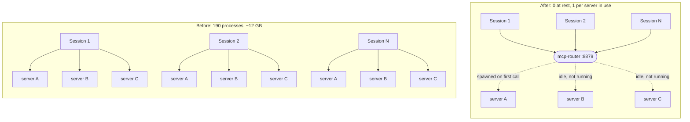
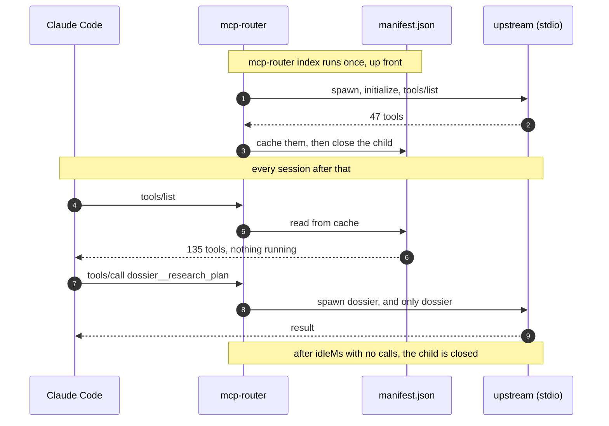
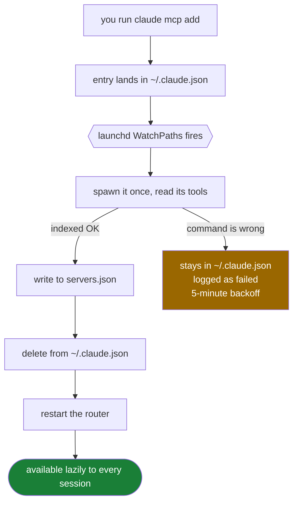

<div align="center">


# mcp-router

**One HTTP MCP endpoint that every Claude Code session shares, which starts a server only when a tool on it is actually called.**

[](#install)
[](#install)
[](#install)
[](https://modelcontextprotocol.io)
[](LICENSE)

</div>

---

## Why this exists

Ten Claude Code sessions were running on my Mac with twelve MCP servers configured. That produced **~190 MCP server processes** and **~12 GB of combined RSS**, and most of those servers were never called once.

That's not a misconfiguration; it's the protocol. **stdio MCP is a 1:1 pipe.** One client, one server process, no multiplexing anywhere in the spec. So ten sessions with twelve servers means up to 120 processes, and every one of them starts at session init whether the session ever touches it or not.

Nothing in Claude Code's config fixes it. `--strict-mcp-config` reduces how many servers a session *declares*, but each declared server still starts eagerly and nothing is shared between sessions. There's no lazy-start option to reach for: the per-server schema accepts `command`, `args`, `env`, `type`, `url`, `headers` and `timeout`, and none of those defer a spawn.

Pooling exists at exactly one place in the spec, and that's the **HTTP transport**. So the router speaks HTTP to Claude Code and stdio to the servers.

On this machine now: **135 tools from 11 upstreams, with 0 child processes running at rest.**



---

## Install

```bash
/bin/bash -c "$(curl -fsSL https://mcp-router.fledgeling.app/install.sh)"
```

That fetches the source to `~/.local/share/mcp-router`, builds it, copies your stdio servers out of `~/.claude.json`, indexes them once, writes two launchd agents with this machine's own absolute paths, loads them, and adds a single `mcp-router` entry to `~/.claude.json`. It backs that file up first.

Start a new Claude Code session afterwards. A session already attached to the router does **not** need restarting for a tool-list change — see [Reaching sessions that are already running](#reaching-sessions-that-are-already-running) — but it was not attached at all until this install finished.

Already have a clone? `./docs/install.sh` from inside it works the same way and skips the fetch, so the agents point at your working copy.

**The two launchd agents run the TypeScript router.** It is the only router the installer builds and points them at. The retired Swift router and its obsolete checks have been removed, so the installer refuses `MCPR_ROUTER=swift` before it builds anything. Node 20.19 or newer is required.

**Note:** the installer is macOS-only because it uses launchd. On Linux, `npm run build` then run `node dist/index.js serve` under systemd; everything else in the router is platform-neutral.

### Uninstall

```bash
/bin/bash -c "$(curl -fsSL https://mcp-router.fledgeling.app/uninstall.sh)"
```

Add `--purge` to also delete `~/.claude/mcp-router` and the fetched source:

```bash
/bin/bash -c "$(curl -fsSL https://mcp-router.fledgeling.app/uninstall.sh)" mcp-router --purge
```

The restore is the half that matters. Every stdio server the router adopted is written back into `~/.claude.json` before the agents go, so you're left with a working setup rather than no MCP servers at all. It won't overwrite a name you've since defined by hand.

---

## How it works

The awkward part is `tools/list`. A client needs the full tool list at startup, and the only way to learn an stdio server's tools is to start it and ask; that's the exact cost being removed. So the router **caches the tool manifest to disk**.



The cache is keyed on each server's `command`/`args`/`cwd`/`env` identity, plus a digest of any env files it loads, so editing one server, or rotating a key in its `.env.local`, invalidates only its own entry. Tools are namespaced `<server>__<tool>` so two servers can't collide.

Spawns are single-flighted, so two concurrent calls to a cold server produce one child rather than two.

---

## Adding a server

Add it the ordinary way. The watcher does the rest.

```bash
claude mcp add --scope user my-server -- /path/to/cmd --flag
```

**It will look like it vanished.** Within seconds the entry disappears from `~/.claude.json`, and that's the watcher working rather than a bug.



Confirm with `mcpr tools | grep my-server`, and `~/.claude/mcp-router/watch.log` records every adoption.

**The order is deliberate: it indexes first and adopts only on success.** A server whose command is wrong stays in `~/.claude.json`, is logged as failed, and never enters `servers.json`; a typo stays visible where you typed it instead of being swallowed into a config that can't serve it.

Three things the watcher deliberately leaves alone:

| Not adopted | Why |
|---|---|
| HTTP/SSE entries | They already pool on their own transport and carry their own OAuth; another hop would strip that context |
| The `mcp-router` entry itself | It would proxy to itself |
| Project scope (`.mcp.json`) and local scope | Deliberately scoped to one repo; that's the point of them |

`~/.claude.json` is ~268 KB, holds live session state for every project, and Claude Code rewrites it constantly. So the watcher hashes **only** the `mcpServers` object and exits in about 100 ms when it's unchanged, which is nearly every fire. It backs the file up before writing, writes via temp file plus rename, re-reads immediately before writing so concurrent session state survives, and abandons the run without writing anything if the parse fails.

### Keys in the server's own `.env` file

A local stdio server usually keeps its API keys where its own README says to: a `.env` or `.env.local` in its package root. The router loads those itself, so the entry needs no `env` block and no `sh -c "set -a; . .env.local; …"` wrapper.

| Entry | What loads |
|---|---|
| sets `cwd` | `<cwd>/.env`, then `<cwd>/.env.local` |
| no `cwd` | the same two files from the nearest ancestor of the entry's script holding a `package.json`, `pyproject.toml`, `Cargo.toml` or `go.mod` |
| `"envFile": ".env.test"` or `["a.env", "b.env"]` | exactly those, relative to that root; a missing one fails the spawn |
| `"envFile": false` | nothing |

Precedence is the router's environment, then the files in order, then the entry's own `env`, which wins. The files are read at every spawn, so a rotated key takes effect on the next start without a config edit. A monorepo root (`pnpm-workspace.yaml`, `nx.json`, `turbo.json`, `lerna.json`, or `workspaces` in `package.json`) is never inferred, because a script inside an app repo would otherwise inherit the app's secrets rather than its own; set `envFile` explicitly to load one there. `GET /servers/<name>` reports the resolved `envFiles`.

Re-registering a server over the control API updates the config but does not restart a child that is already running, so a changed env reaches the process only after that child restarts.

---

## Operating it

```bash
mcpr status          # what is running right now, and how long it has been idle
mcpr tools           # the namespaced tool list, from cache
mcpr index --force   # rebuild the whole cache
mcpr serve --verbose # foreground, with child stderr
mcpr watch --verbose # run one watcher pass by hand
```

Endpoints: `/mcp`, `/health`, `/status`.

**Changing** a server is the one case that isn't automatic, since the watcher only reacts to new entries:

```bash
mcpr import && mcpr index
```

A re-index reaches the running router without a restart: `serve` stats the manifest on each `tools/list` and re-reads it when the mtime moves, keeping the previous manifest if the new one won't parse. Adding a *new* upstream is the one change that needs a restart, because the upstream list is read once at startup, and the watcher does that restart itself.

**Removing** a server means taking it out of `~/.claude/mcp-router/servers.json`, since that is where it lives now rather than `~/.claude.json`:

```bash
node -e 'const f=process.env.HOME+"/.claude/mcp-router/servers.json",d=require(f);delete d.mcpServers["my-server"];require("fs").writeFileSync(f,JSON.stringify(d,null,2))'
mcpr index --force
launchctl kickstart -k "gui/$UID/gg.rhodes.mcp-router"
```

Worth saying that the reason people reach for this has mostly gone. Removing a server used to be how you stopped paying for one you rarely called, because every declared server started at session init whether you touched it or not. Under the router an unused server costs a few kilobytes of cached tool schema and nothing else: no process, no memory, no startup time. So the honest advice is to leave it, unless the tools themselves are cluttering the model's tool list or the server has become a liability.

### The log file

The router writes `router.log` under `MCP_ROUTER_HOME` and rotates it when the next line would take it past the cap. The defaults are 10 MB and five rotated files, and `servers.json` can set both:

```json
"log": { "maxBytes": 10485760, "keep": 5 }
```

Rotated files are `router.log.1` (newest) through `router.log.<keep>`, and the oldest is deleted when a new one is made. `keep: 0` keeps none, so the active file just restarts. `maxBytes` must be a whole number of at least 1 and `keep` a whole number of at least 0; anything else stops the router at startup with a message naming the field. The policy is read at startup, so a change takes effect on the next restart.

While the router writes `router.log`, it sends only error lines to stderr; info and warning lines go to `router.log` alone. The cap does not cover launchd's `serve.err.log`, which holds the error lines and anything Node prints for an uncaught exception, and launchd holds that file open without a limit, so it grows with the errors. `serve` writes no log lines to `serve.out.log`. `index` and `refresh` open `router.log` too, so their info and warning lines appear there rather than on the terminal. A verb that does not open the log file, such as `status` or `tools`, still prints every line to stderr.

---

### Exporting a server list

`mcpr export` writes the server list with every secret value replaced:

```bash
mcpr export --out servers-shareable.json   # every server, to a file (created 0600)
mcpr export --only github,linear           # only the named servers, to stdout
```

`GET /export` on the control API returns the same document. It needs the control token, as the routes that read or change config do.

Each removed value becomes `<redacted:WHERE>`, where WHERE says what it was: `env.API_KEY` for an environment variable, `headers.Authorization` for a header, `args.N` for the Nth argument, and for a URL `url.userinfo`, `url.path`, `url.query.KEY` or `url.fragment`. Keys, names and structure are kept, so the file has the shape of `servers.json`.

Every environment and header value is replaced, including the ones that are not secret, because the router cannot tell them apart. A URL keeps its scheme and host and loses its path, because a path can be the credential itself, as a webhook address is. So a server's route, such as `/mcp`, comes back as a placeholder to fill in by hand. Each query value is replaced, and a query name is kept only when it is a plain word that matches no known secret. A field the router does not recognise is dropped. A field it recognises but cannot read is replaced. An `envFile` keeps its path, and its contents are never read.

**Fill the placeholders in by hand.** Importing an exported file is not built, so nothing reads the placeholders back. Replace each `<redacted:…>` with its real value before the file is used as a server list. A placeholder left in place is sent to the server as literal text.

## Reaching sessions that are already running

Two mechanisms, and the difference between them is the whole of what this section is for. One
**tells** and needs nobody. The other can only **ask**.

| What changed | Mechanism | Who it reaches | When | Needs a person? |
|---|---|---|---|---|
| The tool list — a server added, removed, re-indexed, disabled, or re-scoped | `notifications/tools/list_changed` over the stream the session already holds | every session attached to this router | ~100 ms, mid-task | no |
| Skills, plugins, harness config | a message on the session's own unix socket | every live session on this machine, if you turn it on | at that session's next tool round | **yes** |

### The tool list: the router tells, and nothing is asked of anybody

A Claude Code session opens a standalone `GET /mcp` SSE stream immediately after it initializes
and holds it for the whole session. That is a channel from server to client, and
`notifications/tools/list_changed` is what goes down it: the client re-fetches `tools/list` on
its own, with no model in the loop, no slash command and no person.

The router now keeps a reference to those streams and sends that notification whenever the served
tool list actually moves. Measured on a real client: **104 ms** from `POST /servers` returning to
the attached session re-fetching and seeing the new tool. A session inside a long-running tool
call is not disturbed by it — the re-fetch is the client's own housekeeping.

It is deliberately silent about changes that do **not** move the tool list. Setting `warm` on a
server changes how it is run, not what it serves, so it announces nothing; a notification is a
re-fetch every attached session pays for.

Two things it cannot do, which is why the other half exists:

- **It carries no payload.** The protocol gives `list_changed` no field for what changed, so this
  cannot name the server that moved. It says "re-read"; the client works out the difference.
- **It only covers the tool list.** Skills, plugins and harness config are not in this protocol.

### Skills and plugins: the router asks, and asking is all it can do

Every Claude Code session registers a unix socket, and the router can write to it:

```
/tmp/cc-socks/<pid>.sock
```

What arrives there is **text in the receiving session's turn**. Three measured limits, and they
are the reason this is off by default:

- **A slash command in the message does not run.** The harness enqueues an inbound peer message
  with slash commands disabled. So `/reload-skills` in the body is a string the receiving model
  reads, not a command anything executes. This is a property of the receiver — not a convention.
- **It drains at that session's next tool round.** A session sitting idle with nobody at the
  keyboard holds the message until it next does something. There is no wake in this.
- **The router cannot observe whether anyone complied.** So the outcome it reports is
  `delivered` — the bytes reached that session's inbox — and never `reloaded`.

It is **off unless you turn it on**, because everything it reaches is somebody's turn:

```bash
mcpr sessions              # who is reachable, by which mechanism; sends nothing
mcpr sessions --dry-run    # who the ask WOULD reach; still sends nothing
mcpr sessions --push       # ask them, now
```

Turn the automatic version on by adding `"notifySessions": true` at the top level of
`~/.claude/mcp-router/servers.json`. It is read on each change rather than cached, so turning it
off takes effect immediately.

### A session that cannot be reached says which kind of "cannot"

`mcpr sessions` and `GET /sessions` classify every registry entry, because "unreachable" collapses
five different situations into one and only one of them is a problem:

| Class | What it means |
|---|---|
| `reachable` | alive, identity verified, socket present, key file found |
| `no key file` | alive and addressable, but the message would go unauthenticated |
| `exited` | the process is gone. The registry outlives its sessions; this is the normal case |
| `pid reused` | something is alive on that pid, but it is not the process that registered |
| `no socket` | registered and alive, but the socket file is not there |

The identity check compares **instants, not spellings**: the registry writes `procStart` in UTC
and `ps` prints local time, so comparing the two as strings classifies every live session on a
non-UTC machine as `pid reused` — reporting nobody reachable at the moment everybody is.
`scripts/e2e-session-push.mjs` plants a session in each spelling and requires the classifier to
tell them apart.

### Which router this is in

Both mechanisms are in the **TypeScript** router, and a stock install runs it, so `mcpr sessions` reports the registry and the notification reaches it. The Swift router had no `/sessions` route and answered `404`; it is retired, so a reinstall can no longer put a machine on it.


### What neither reaches

Claude Desktop has no `cc-socks` socket and does not attach to this router, so neither mechanism
reaches it. A session that has never connected to the router has no stream; it is reported as
absent rather than as a failure.

---

## Profiles, and the sync that already happened

A **profile** is a name over the extensions this router holds and the upstreams it serves —
`{"skills": [...], "plugins": [...], "marketplaces": [...], "servers": [...]}` — stored at
`<router home>/profiles/<name>.json`. Its **projection** says what each harness on this machine
would have to hold for that profile to be satisfied there.

```
POST   /profiles/<name>              # write or replace one; a selected name that escapes is refused
GET    /profiles                     # every profile, read off the directory on the call
GET    /profiles/<name>
GET    /profiles/<name>/projection   # what it would require, harness by harness
DELETE /profiles/<name>              # moved to <root>/.removed/<name>/<millis>.json, never deleted
```

### The projection reads and never writes

Nothing applies it. The body carries `"applies": false` as a member rather than as a footnote, and
`scripts/lint/no-harness-skill-writes.sh` at `735a5de5fdad909aaa351ec9948f1522fcf93c0b` (historical source) fails the build if an applier appears anywhere under
`app/Sources` — the same refusal `no-harness-config-writes.sh` holds for a harness's MCP
configuration, extended to the second kind of tree this router now reads.

### Why detection is the product

Measured on the author's machine on 2026-08-29, read-only, listing each root and calling
`islink`/`exists` on every entry:

| root | entries | symlinks | dangling |
|---|---|---|---|
| `~/.claude/skills` | 23 | 21 | 1 |
| `~/.cursor/skills` | 87 | 87 | **27** |
| `~/.cursor/skills-cursor` | 22 | 0 | 0 |
| `~/.codex/skills` (Codex and ChatGPT share it) | 1 | 1 | 0 |
| `~/.gemini/skills` | 1 | 1 | 0 |
| `~/.config/opencode/skills` | 1 | 1 | 0 |
| Claude Desktop, grok | — | — | no skills directory at all |

The propagation a profile manager is usually asked to perform had already been done here, by hand,
with symlinks — and **31% of Cursor's had rotted**, every one of them pointing into
`~/.claude/plugins/cache/<marketplace>/<plugin>/<version>/`, which an upgrade replaces. The
harness that loses the skill is not the harness the upgrade happened in, and nothing said so.
`~/.claude/skills` and `~/.cursor/skills` share exactly **one** name.

So a dangling link is projected as a **repair** naming the target it still claims, never as an
absent entry, and a harness with no skills directory is named rather than omitted.

### Each step says how far the router could get

Three reaches, and all three occur here:

- **`durable`** — the bytes would land and stay, and nothing makes a live session re-read them.
  Skills and plugins have no `notifications/tools/list_changed` equivalent, and the socket half
  above enqueues a slash command as text.
- **`tell-elsewhere`** — the router's served tool set is the one thing a profile touches that the
  protocol can announce, and that announcement is in `src/livereload.ts`. The profile store is in
  the Swift router, which has no counterpart, so the mechanism is reported and not claimed.
- **`refused`** — a step needing another program's MCP configuration rewritten. This router does
  not do that; see `planning/specs/spec-R7.md` §7.

**There is no single-click sync**, and there are two independent reasons rather than one: the
router does not write another program's configuration, and even where it wrote the bytes nothing
would make a running session read them.

---

## What it deliberately doesn't do

- **It doesn't proxy HTTP/SSE upstreams.** Those are already shared endpoints with their own auth; routing them through here adds a hop and strips their OAuth context.
- **It doesn't bind beyond loopback.** This endpoint runs every MCP server you own, with your environment. It must not be reachable from the network. Loopback alone isn't quite enough, though: a web page can point a hostname it controls at `127.0.0.1`, which makes the request same-origin and skips the preflight that would otherwise stop it. So the `Host` header is checked too, and anything that isn't this router's own address gets a 403.
- **It doesn't proxy prompts or resources**, only tools.
- **It doesn't cover Claude Desktop.** That app's per-server schema requires `command` and has no `url` or `type` field, so an HTTP entry fails validation and gets dropped with a "Some MCP servers could not be loaded" dialog. Remote servers reach Desktop through Settings > Connectors instead.

---

## The trade it makes

Worth being straight about, because it's a real one. **One process now sits in front of every MCP server you have**, and since the cutover it's the only path Claude Code has to them rather than an opt-in one. If it dies, every session loses every tool at once, where before a failure was isolated to one server in one session.

`KeepAlive` in the plist is what covers that, and `~/.claude/mcp-profiles/*.json` with `--strict-mcp-config` is the way back to direct stdio if you ever need it.

A dead or broken upstream returns a JSON-RPC tool error naming the server. It doesn't propagate; one broken server can't take the other ten down, and the router stays up. That's verified against `docker-mcp` with the Docker engine stopped.

**One launchd trap, measured rather than theorised:** do not set `ProcessType: Background` in either plist. It throttles startup I/O hard enough that the process never reaches `listen()`, while `launchctl` reports the agent running the whole time with an empty log. It looks exactly like a hang.

---

## Tests

```bash
node scripts/e2e.mjs        # against a running router
node scripts/e2e-idle.mjs   # self-contained; starts its own router
make node-e2e               # both halves of the live reload, self-contained
```

Ten checks against a running router using the SDK's own client, which is the same one Claude Code uses: initialize, `tools/list` served from cache, namespacing, `tools/call`, that the called upstream started, **that no other upstream started**, and that an unknown server errors without crashing the router.

`make node-e2e` runs the two live-reload proofs. `e2e-live-reload.mjs` boots a router in its own `HOME`, attaches the SDK's own client, adds a server over the control API and requires the attached client to have been told and to see the new tool — with two controls: a change that moves no tools must announce nothing, and a push with nobody attached must report **0 delivered** rather than a full delivery. `e2e-session-push.mjs` builds its own session registry, binds its own socket and pushes only at that; it never reads the real registry, because a live session on this machine is somebody else's work.

`e2e-idle.mjs` is a regression check with its own upstream and its own `HOME`, so it touches nothing you have configured. It proves a call that runs longer than the idle window is not cut off by the reaper — before the pool counted in-flight calls, a six-second call against a two-second window came back as `MCP error -32000: Connection closed`, which at the default five-minute window meant every long-running tool call died at five minutes.

---

## Documentation map

| File | What it covers |
|---|---|
| `src/manifest.ts` | The tool cache and its reload semantics; why lazy spawning is possible at all |
| `src/livereload.ts` | The streams attached sessions already hold, and the one notification worth sending down one |
| `src/sessions.ts` | The session registry, the five reach classes, and why the socket half can only ask |
| `src/pool.ts` | Child lifecycle: single-flight spawn, idle reaping |
| `src/envfile.ts` | Which `.env` files a local server gets, and why a workspace root is never inferred |
| `src/router.ts` | The stateless HTTP layer and how a dead upstream is contained |
| `src/watch.ts` | The adoption watcher and its refusal behaviour |
| `docs/install.sh` | What the one-liner actually does, in order (and what GitHub Pages serves) |
| `vendor/README.md` | The pinned `test-campaign` copy the campaign gates run from, and how to check the pin |

---

## Design


The mark is a manifold: cool glass conduits converge from the left into one hub, and on the right exactly one branch is lit while the others sit dormant. Many-to-one on the way in, lazy-wake on the way out, which is the whole program in one shape.

It lives in `design/icon/`, alongside the layered SVG master, its build script, the alternate takes, and `audit.html`, where every take is scored against the 12-point macOS icon rubric at 128 / 64 / 48 / 32 / 16, losers included with the reason they lost.

[mcp-router.fledgeling.app](https://mcp-router.fledgeling.app/) is a single-page explanation of the same idea for someone who doesn't know what MCP is. It lives in `docs/`, which is also what serves the install script.

<br clear="left" />

---

<div align="center">
<sub>Built by <a href="https://github.com/fledgeling-co">fledgeling</a>. MIT licensed.</sub>
</div>
